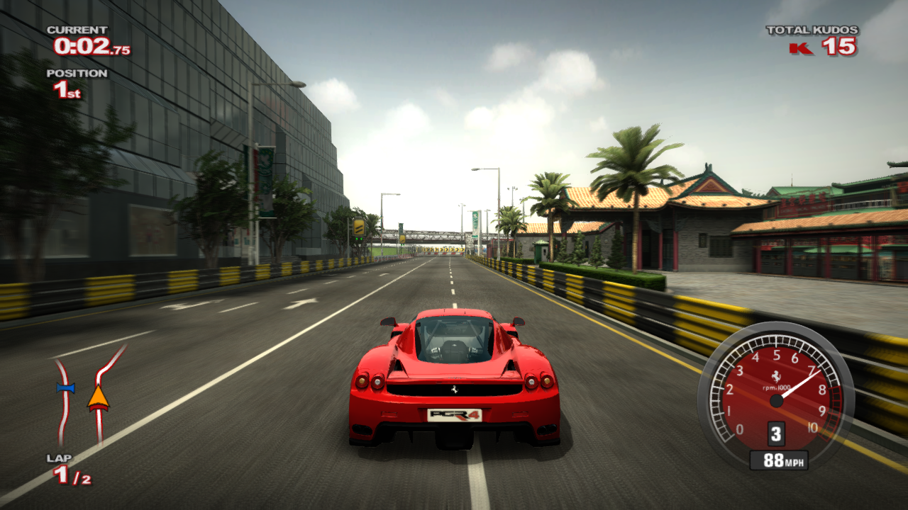

# Project Gotham Racing 4 — Static Recompilation



A native Windows (x64) port of the Xbox 360 *Project Gotham Racing 4* (Bizarre Creations / Microsoft, 2007),
produced by **static recompilation**: every PowerPC function in the retail `default.xex` is translated to
C++, compiled with Clang and linked against a replacement Xbox 360 kernel, XAM, audio, input and GPU runtime.
No emulator CPU core, no interpreter, no JIT — the game's own code runs directly on your CPU, and its Xenos GPU
command stream is rendered with Direct3D 12.

Built on the [ReXGlue SDK](https://github.com/rexglue/rexglue-sdk) (recompiler + Xenia-derived runtime,
BSD-3-Clause) at **v0.10.0**, built from source with five local patches — see [SDK changes](#sdk-changes).

> **No game content is in this repository.** You need your own legally obtained copy of the game. The
> generated C++, the build output and every runtime log or snapshot are derived from the game and are
> git-ignored.

**Status: boots, plays the intro movie, title screen, profile dialog, menus and full races at a steady
60 fps (adaptive vsync), with audio, saving and a gamepad, in a window whose title shows fps, draws and
triangles.** One known rendering problem (crowd skeletons / sky wedges) is worked around, not fixed.
See [Status](#status) for what works and what doesn't.

---

## Contents

- [Requirements](#requirements)
- [First-time setup with the launcher](#first-time-setup-with-the-launcher)
- [Getting the game files](#getting-the-game-files)
- [Building](#building)
- [Running](#running)
- [Controls](#controls)
- [How the recompilation works](#how-the-recompilation-works)
- [Status](#status)
- [Repository layout](#repository-layout)
- [Debugging](#debugging)
- [Legal](#legal)

---

## Requirements

| | |
|---|---|
| OS | Windows 10/11, x64 |
| Compiler | [LLVM](https://llvm.org/) Clang 18+ in `C:\Program Files\LLVM` (tested with clang 23.1.3), plus Visual Studio 2022 **Community** with the *Desktop development with C++* workload (for `vcvars64.bat`, the Windows SDK and Ninja) |
| Build tools | CMake 3.25+ in `C:\Program Files\CMake`, Ninja (the copy bundled with Visual Studio is used), Git for Windows |
| Python | 3.10+ for the helper scripts (only needed for the test/debug tooling; `autopilot.py` also needs Pillow) |
| GPU | A Direct3D 12 GPU with rasterizer-ordered views (the default render path; tested on an RTX 4080 SUPER) |
| Controller | An XInput gamepad (Xbox 360 / One / Series controller) |
| Game | A **retail Project Gotham Racing 4 Xbox 360 disc dump** that you own (see below) |
| Disk | ~7 GB free for the extracted game (6.2 GB) + ~140 MB generated C++ + the SDK and build trees |

`scripts\build.bat` and `scripts\build_sdk.bat` hard-code those Visual Studio, LLVM and CMake install folders;
edit the `PATH`/`vcvars64.bat` lines at their top if yours differ.

## Getting the source

The scripts expect this repository and the SDK source side by side under one parent folder:

```
<parent>\
  pgr4recomp\           this repository
  _ext\rexglue-sdk\     ReXGlue SDK source (v0.10.0)
  pgr4_files\           your extracted disc (see below)
```

Clone the SDK at the v0.10.0 tag (commit `c94f5eb`), with its submodules:

```bash
git clone --recursive --branch v0.10.0 https://github.com/rexglue/rexglue-sdk.git _ext/rexglue-sdk
```

**Windows checkout gotcha:** git symlinks inside the SDK's submodules (libmspack `cabextract/mspack/*.c`,
o1heap) arrive as one-line text files. Replace each mode-120000 entry with a copy of its target before
building.

## First-time setup with the launcher

The launcher does everything in [Getting the source](#getting-the-source) (the SDK part),
[Getting the game files](#getting-the-game-files) and [Building](#building) for you:

1. Download `pgr4recomp-<version>-windows.zip` from this repository's releases page and unzip it to a short
   path such as `C:\Games`. It holds the source and the launcher, and no game content.
2. Run `pgr4_launcher.exe`. It opens on the **Setup** page.
3. Choose your disc image (*Disc image…*) or a folder with the extracted disc (*Folder…*), and press
   **Run setup**. When it is done, press **Play**.

The step-by-step guide, shared by every game that uses the launcher, is
**[First-time setup](https://github.com/taxidriverhk/recomp-launcher#readme)** (also in
`launcher\README.md`). It covers choosing the game copy, installing the build tools, what each step does,
troubleshooting, updating and running from a git clone.

What is specific to Project Gotham Racing 4:

| | |
|---|---|
| Game copy | The retail Xbox 360 disc as a full XGD2 dump, or its extracted game partition, with `default.xex` matching the SHA-1 in [Getting the game files](#getting-the-game-files). It goes into `assets\`. |
| Build tools | Git, Visual Studio 2022 **Community** with the C++ workload, LLVM and CMake, in their default install folders (the build scripts expect them there). The launcher offers to install them with winget. |
| Build | `scripts\setup_sdk.ps1` clones the ReXGlue SDK into `..\_ext\rexglue-sdk`, **next to** the game folder, then patches and builds it (the longest part). Codegen and `scripts\build.bat` follow. Later installations next to it reuse the SDK. |
| Disk | About 7 GB for the extracted disc, plus the SDK and build trees. |
| Rebuild | Setup skips codegen and the build once their output exists. After changing code, see [Building](#building). |

A new release is built by pushing a `v*` tag (`.github/workflows/release.yml`).

## Getting the game files

The codegen overrides and the hooks are tied to one specific executable. Check yours:

| | |
|---|---|
| Title ID | `4D5307F9` |
| Media ID | `0x5A381A4E`, version 1, disc 1/1, region-free |
| XDK | 2.0.6132 |
| `default.xex` size / SHA-1 | 12,431,360 bytes, `1a7e3b9ee84ef5f3ea1db66e6b1e3eb4f96b0cdd` |

`config/default.toml` names guest addresses (e.g. the present-interval hook at `0x826957EC`). A different
revision of the XEX will not work without redoing them.

1. Dump the disc from **your own** console/disc into an ISO (XGD2).
2. Extract the game partition (XDVDFS at offset `0xFD90000` on an XGD2 image) into `pgr4_files\` next to
   this repository, with the bundled extractor:

   ```bat
   python -I scripts\xiso_extract.py "Project Gotham Racing 4.iso" ..\pgr4_files 0xFD90000
   ```

   You should end up with 1033 files: `default.xex`, `gw.xex`, `ai.pak`, `cultures.txt` and the folders
   `Camera`, `Game`, `Movies`, `UI`, `gw`, `loc`.
3. Point the `assets` folder (the SDK's game root; git-ignored) at it with a junction, from the repository
   root:

   ```bat
   mklink /J assets ..\pgr4_files
   ```

   (Or extract straight into `assets\`.) `assets\default.xex` must exist before codegen.

## Building

All commands run from the repository root unless noted.

### 1. Patch and build the SDK (once, and after changing a patch)

Apply the patches in this order (each one is a plain `git diff` of the SDK tree):

```bat
git -C ..\_ext\rexglue-sdk apply ..\..\pgr4recomp\patches\rexglue-draw-debug.patch
git -C ..\_ext\rexglue-sdk apply ..\..\pgr4recomp\patches\rexglue-gpu-frame-stats.patch
git -C ..\_ext\rexglue-sdk apply ..\..\pgr4recomp\patches\rexglue-texture-heap-pool.patch
git -C ..\_ext\rexglue-sdk apply ..\..\pgr4recomp\patches\rexglue-vpkd3d-float16-range.patch
git -C ..\_ext\rexglue-sdk apply ..\..\pgr4recomp\patches\rexglue-x360-half-vertex-kill.patch
```

Then build and install it:

```bat
scripts\build_sdk.bat
```

This configures the SDK's `win-amd64` preset and installs to `..\_ext\rexglue-sdk\out\install\win-amd64`
(`bin\rexglue.exe`, `rexruntime.dll`, `rexgpu-xenos.dll`). It prints `SDK_BUILD_OK` at the end. The SDK is
built from source because the prebuilt v0.10.0 Windows zip was flagged by Defender (a heuristic hit); the
local build was not.

### 2. Generate the C++ (first time, or after changing `config/*.toml`)

```bat
..\_ext\rexglue-sdk\out\install\win-amd64\bin\rexglue.exe codegen pgr4recomp_manifest.toml
```

About 16 seconds. It reads `assets\default.xex` plus the overrides in `config/ptr_funcs.toml` and
`config/default.toml` and writes `generated\default\` (~269 files, ~138 MB; git-ignored). It should report no
unresolved calls; the only expected warning is that `0x8256E8C0` produces a file over the size limit.

### 3. Build the game

```bat
scripts\build.bat
```

About 50 seconds for a full build. It configures the `win-amd64-release` preset (Clang + Ninja) against the
installed SDK and prints `BUILD_OK`. The output is `out\build\win-amd64-release\pgr4recomp.exe`, with the SDK
DLLs copied next to it. `scripts\build.bat debug` and `scripts\build.bat relwithdebinfo` select the other
presets.

**After rebuilding the SDK**, the game build does not pick up the new DLLs by itself (they are copied only at
configure time): copy `rexgpu-xenos.dll` and `rexruntime.dll` from the SDK's `out\install\win-amd64\bin` into
`out\build\win-amd64-release` by hand.

## Running

Plug in the gamepad first, then double-click `pgr4_launcher.exe` in the repository root (the build puts it
there and next to the game). It is a settings window — window size, fullscreen, 60 fps, resolution scale,
AA, anisotropic filtering, log level — that passes your choices as cvars (overriding `pgr4recomp.toml`) and
saves them to `launcher.user.ini`. The options are in `launcher.ini`; the launcher itself is the `launcher/`
submodule ([recomp-launcher](https://github.com/taxidriverhk/recomp-launcher)). `pgr4_launcher.exe --play`
starts the game straight away with the saved settings.

By default it starts `out\build\win-amd64-release\pgr4recomp.exe` in a 1280×720 window with `assets` as the
game root and writes the log to `work\play.log`. Any other cvar goes in the launcher's *Extra arguments* box,
or after `--`: `pgr4_launcher.exe --play -- --vsync=false`.

Always pass `--fullscreen=false` (as the launcher and `scripts\run.ps1` do) when starting the exe yourself: the
SDK's `fullscreen` cvar defaults to true. Passing the same cvar twice makes the exe exit at startup with no
log.

The title bar reads `pgr4recomp [<sdk build>] - 60 fps, 6258 draws, 3525k tris`, updated once a second.
Expect the Dolby logo and the intro movie (press Start to skip), then *PRESS START TO CONTINUE*. A brand-new
profile goes straight into a first race in St Petersburg; the main menu comes after it. Saves go to
`<Documents>\pgr4recomp` (delete that folder to start over with a fresh profile).

### Settings

The SDK reads flat `cvar = value` settings from `pgr4recomp.toml` next to the exe. The build copies
`config/pgr4recomp.toml` there once and never overwrites it, so edit the copy in
`out\build\win-amd64-release`. Command-line flags override it.

| Setting | Default | Effect |
|---|---|---|
| `pgr4_60fps` | `true` | Present every vblank instead of the game's 30 fps lock. Gameplay runs in real time either way |
| `pgr4_adaptive_vsync` | `true` | With `pgr4_60fps`: present at once and pace to 60 fps on the host, so a frame that just misses the vblank shows at ~17 ms instead of 33 ms. `false` = wait for the vblank |
| `resolution_scale` | `1` | Internal render scale: 1 = the game's own resolution, 2 = 4× supersampling, 3 = 9×. The game's own EDRAM MSAA stays on at every scale. 2 holds 55–60 fps in races on an RTX 4080 SUPER |
| `swap_post_effect` | `"fxaa"` | Post-process AA on the final image: `"none"`, `"fxaa"`, `"fxaa_extreme"` |
| `present_effect` | `"bilinear"` | Scaling to the window: `"bilinear"`, `"cas"` (sharpen), `"fsr"` (FSR 1 upscale + sharpen) |
| `anisotropic_override` | `5` | -1 game default, 0 off, 1..5 = 1×/2×/4×/8×/16× |

Other cvars this port adds:

| Cvar | Default | Effect |
|---|---|---|
| `pgr4_title_stats` | `true` | fps, draws and triangles per frame in the window title |
| `pgr4_hitch_ms` | `25` | Log a `PGR4 hitch` line with a GPU / guest time breakdown for every frame longer than this; 0 = off |
| `pgr4_crowd_cull` | on | Skip crowd draws whose bones are scattered (the sky-wedge workaround, see [Status](#status)) |
| `d3d12_texture_heap_pool` | `true` | Place textures in pooled 64 MB heaps instead of one committed resource each |

PGR4 also changes three SDK defaults in `src/pgr4recomp_app.h` (an explicit command-line or config value still
wins): `render_target_path_d3d12=rov` (the default RTV path renders the front end black),
`clear_memory_page_state=false` (races go from ~38 to ~60 fps) and `x360_half_vertex_kill=true`.

## Controls

Player 1 is the first XInput controller through the SDK's input system; it maps 1:1 onto the Xbox 360 pad the
game expects. The SDK also ships SDL and keyboard/mouse input drivers; they have not been tried with PGR4.

For unattended test runs `src/scripted_input.h` adds a synthetic pad, merged with a real one, when
`PGR4_PAD` (a timed button list) or `PGR4_PAD_FILE` (a live command file) is set; the syntax is documented at
the top of that header.

---

## How the recompilation works

```
 default.xex ──► rexglue codegen ──────────────────────────────► generated/default/*.cpp ──► Clang ──► pgr4recomp.exe
                  (decrypt + decompress, .pdata function           (PPC → C++, one C++          │            │
                   bounds, + config/ptr_funcs.toml and               function per guest          │            │ loads
                   config/default.toml overrides, midasm hooks)      function)                   │            ▼
                                                                                    src/*.cpp ───┘   rexruntime.dll  (kernel, XAM, audio, input)
                                                                                                     rexgpu-xenos.dll (Xenos → D3D12)
```

### 1. Lifting PowerPC to C++ (offline)

`rexglue codegen pgr4recomp_manifest.toml` does the whole job: it decrypts and decompresses the XEX (retail
AES key, basic compression), takes function boundaries from the ~20.9k `.pdata` entries and emits C++ in which
the guest registers live in a PPC context and guest memory is one big-endian 32-bit address space. Two
override files fill the gaps `.pdata` leaves:

- **`config/ptr_funcs.toml`** — 2,912 code entry points reachable only through data pointers (vtable forwarding
  stubs and the like), generated by `scripts/find_ptr_funcs.py`. Without them the game dies with *"Call to
  invalid or unregistered function"*.
- **`config/default.toml`** — hand-checked fixes: five leaf functions without `.pdata` reached by tail
  branches, three MSVC C++ exception-handler layouts whose last catch funclet swallows the parent's epilogue,
  and the `[[midasm_hook]]` at `0x826957EC` that lets the 60 fps patch change the present interval. Byte patches
  do not reach recompiled code, so game patches are codegen hooks; rerun codegen after editing them.

### 2. The runtime (ReXGlue SDK)

At run time the recompiled code thinks it is on an Xbox 360. The SDK, derived from Xenia, provides the
`xboxkrnl.exe` and `xam.xex` exports the game imports (339 and 236 import records), threads, file I/O with the
game root mapped to `assets\`, saves under `<Documents>\pgr4recomp`, audio, input, and the Xenos GPU
command processor that turns the game's own D3D9 command buffers into Direct3D 12, with EDRAM emulated in
pixel shaders (ROV path).

### 3. The game layer (this repository)

- **`src/main.cpp`, `src/pgr4recomp_app.h`** — the app: loads the Xenos GPU plugin, sets the PGR4 defaults
  (ROV render targets, page-state clearing off, half-float vertex kill and crowd cull on), installs the
  scripted pad and puts the frame stats in the window title.
- **`src/game_patches.cpp`** — the present-interval hook (`pgr4_60fps`) and adaptive vsync
  (`pgr4_adaptive_vsync`: present immediately, pace to a 60 Hz schedule on the host with a waitable timer).
- **`src/xam_fixes.cpp`** — a real empty `XamCreateEnumeratorHandle`; the SDK stub's error made the game's
  online worker close handle `-1` and crash at boot whenever a save existed.
- **`src/frame_stats.cpp`, `src/import_trace.cpp`** — counts frames at the guest `VdSwap`, reads the GPU
  counters the SDK patch exports, times the game's D3D fence spin-wait, and writes the title stats and the
  hitch log. `PGR4_TRACE_IMPORTS=1` also logs selected XAM calls.

`NOTES.md` is the detailed engineering log: every bug found, why, and how it was fixed — read it before
changing anything.

### SDK changes

`..\_ext\rexglue-sdk` is the upstream v0.10.0 tag (`c94f5eb`) plus these patches, kept in `patches/` and
applied in this order:

| Patch | What it does |
|---|---|
| `rexglue-draw-debug.patch` | Draw-debug hooks in the D3D12 command processor, active only with `REX_DRAW_DEBUG_FILE=<file>` (skip/dump/trace draws by shader or vertex buffer, re-read live), and the `pgr4_crowd_cull` workaround |
| `rexglue-gpu-frame-stats.patch` | `include/rex/graphics/gpu_frame_stats.h`: cumulative GPU counters and timers exported from `rexgpu-xenos.dll` as `rex_gpu_frame_stats()` |
| `rexglue-texture-heap-pool.patch` | Textures as placed resources in pooled 64 MB heaps (`d3d12_texture_heap_pool`): 0.26 → 0.014 ms per texture creation |
| `rexglue-vpkd3d-float16-range.patch` | Codegen fix: `vpkd3d128` FLOAT16 packing saturated at 65504; the Xbox 360 half has no Inf/NaN and goes to 131008 |
| `rexglue-x360-half-vertex-kill.patch` | `x360_half_vertex_kill`: vertices whose 16-bit float fetch has exponent 31 (how the game hides crowd props) are moved outside the clip volume |

After changing SDK files, regenerate the matching patch with `git -C ..\_ext\rexglue-sdk diff -- <files>`.
`rexglue-draw-debug.patch` and `rexglue-gpu-frame-stats.patch` both touch
`src/graphics/d3d12/command_processor.cpp`, so split a change to that file between them by hand.

---

## Status

**Works**

- Boot, the Dolby logo and intro Bink movie (with sound), title screen, Gamer Profiles dialog, main menu,
  Single Player / Arcade Mode, event cards, Custom Match (city / route / lobby / car select)
- Full races (St Petersburg street race tested most; Shanghai at night and Macau too) with world, HUD, minimap, results
  and end-of-race screens
- 60 fps races; with adaptive vsync 90 s of racing shows a 60.0 fps mean and one frame over 25 ms
  (the race start, which creates ~570 textures at once)
- Window title stats (fps, draws, triangles per frame) and a per-frame hitch log
- Saving and loading the profile
- Supersampling (`resolution_scale`), FXAA, CAS/FSR present, 16× anisotropic filtering
- Gamepad input

**Open issues**

1. **Sky wedges / crowd skeletons.** Crowd members' bones come out hundreds to thousands of units apart, so
   the grandstands look empty and stray crowd triangles flicker across the sky as grey (day) or orange (night)
   wedges. The data is the game's own, so it is most likely a recompiled-CPU bug in the crowd animation code.
   `pgr4_crowd_cull` hides it (0 wedges in 256 test frames); the cause is not fixed.
2. **GPU command processor cost per draw** (~1.3 µs). Dense views reach 7–9k draws per frame, leaving
   2–3 ms of headroom; `resolution_scale` 2 or a slower CPU can drop frames again.
3. **Race-start hitch**: one long frame (70–100 ms) while ~570 textures are created and 72 MB uploaded.
4. The default RTV render-target path renders the front end black (root cause not pinned down); the ROV path
   is used instead.
5. setjmp/longjmp were not located in the binary; Lua error paths are untested.
6. Xbox Live / System Link and the bundled *Geometry Wars: Waves* (`gw.xex`) are untested.

## Repository layout

| Path | What it is |
|---|---|
| `CMakeLists.txt`, `CMakePresets.json` | Builds `pgr4recomp.exe` from the generated C++ + `src/` against the installed SDK |
| `pgr4recomp_manifest.toml` | Codegen project file (game root `assets`, entry `assets/default.xex`, override includes) |
| `generated/rexglue.cmake` | SDK CMake boilerplate written by `rexglue init` |
| `config/default.toml` | Hand-written codegen overrides and the present-interval hook |
| `config/ptr_funcs.toml` | Generated pointer-only entry points (`scripts/find_ptr_funcs.py`) |
| `config/pgr4recomp.toml` | Default user settings, copied next to the exe on the first build |
| `src/` | Game layer: app, hooks, XAM fix, frame stats, import trace, scripted pad |
| `patches/rexglue-*.patch` | This port's changes to the SDK |
| `launcher.ini`, `launcher/` | Launcher settings, and the launcher itself (submodule); builds `pgr4_launcher.exe` |
| `scripts/build_sdk.bat`, `scripts/build.bat` | Build + install the SDK; configure + build the game |
| `scripts/setup_sdk.ps1` | Clone, fix up, patch and build the SDK in one go (the launcher's Setup page runs it) |
| `scripts/run.ps1`, `scripts/snap.ps1` | Test launch (960×540 window, log in `work\<tag>.log`); window snapshot that works while covered |
| `scripts/boot_steps.ps1`, `goto_race.ps1`, `race_probe.ps1`, `bench.ps1`, `autopilot.py` | Scripted runs: menu stepping, getting to a race, benchmarks, a minimap-following autopilot |
| `scripts/hitch_stats.py`, `tsample.py` | Frame-pacing summary of a log; thread sampling profiler |
| `scripts/sky_bench.ps1`, `sky_probe.py`, `skip_probe.py`, `bisect_vs.sh`, `bisect_vf.sh` | Sky-wedge reproduction, detection and draw bisection |
| `scripts/xexinfo.py`, `xexdec.py`, `pesect.py`, `xiso_extract.py` | XEX header dump, XEX → PE decryption, PE sections, XISO extraction |
| `NOTES.md` | Engineering log |
| `docs/` | README screenshot |
| `generated/default/` | *(ignored)* generated C++ |
| `out/` | *(ignored)* build tree |
| `work/` | *(ignored)* logs, snapshots, PE image, pad command files |
| `assets` | *(ignored)* junction to your extracted disc |

## Debugging

A few starting points (details in `NOTES.md`):

- `& scripts\run.ps1 <tag> [cvars...]` starts a 960×540 window with `--log_level=info` and logs to
  `work\<tag>.log`; `& scripts\snap.ps1 out.png` snapshots the window without focusing it.
- `& scripts\boot_steps.ps1 <tag> 'START,START,A,A' <delay>` presses one button per step through the live pad
  file and snapshots each screen; `python scripts\autopilot.py 120 0.7` then drives a race unattended by
  following the minimap (run it without `-I`; it needs Pillow from user site-packages).
- `pgr4_hitch_ms` logs `PGR4 frames:` once a second and a `PGR4 hitch swap #N:` breakdown for slow frames;
  `python scripts\hitch_stats.py work\<tag>.log [skip] [secs]` summarises a race.
- `REX_DRAW_DEBUG_FILE=work\drawdbg.txt` enables the draw-debug hooks (keys documented above `DrawDebugSkip` in
  the patch); `scripts\skip_probe.py` and the bisect scripts drive it against a running game.
- `--render_target_path_d3d12=rtv` brings back the black front end for comparison; `--log_level=debug` logs
  render target creation.
- For CPU profiles, build `rexgpu-xenos` as RelWithDebInfo and sample the "GPU Commands" thread with
  `scripts\tsample.py`, then symbolize with `llvm-symbolizer`.

## Legal

This is an independent, non-commercial preservation and research project. It is not affiliated with or
endorsed by Microsoft, Xbox Game Studios, Bizarre Creations or any car manufacturer.
*Project Gotham Racing* and all related assets are the property of their respective owners.

This repository contains **no game code, data or assets**: no XEX, no disc content, no generated C++, no
builds. To use it you must own the game and extract the files from your own disc. Do not open issues or pull
requests containing game files, generated code or links to them.

The ReXGlue SDK is BSD-3-Clause licensed and derived from Xenia (see its `LICENSE`); the patches in `patches/`
modify it under that license.
